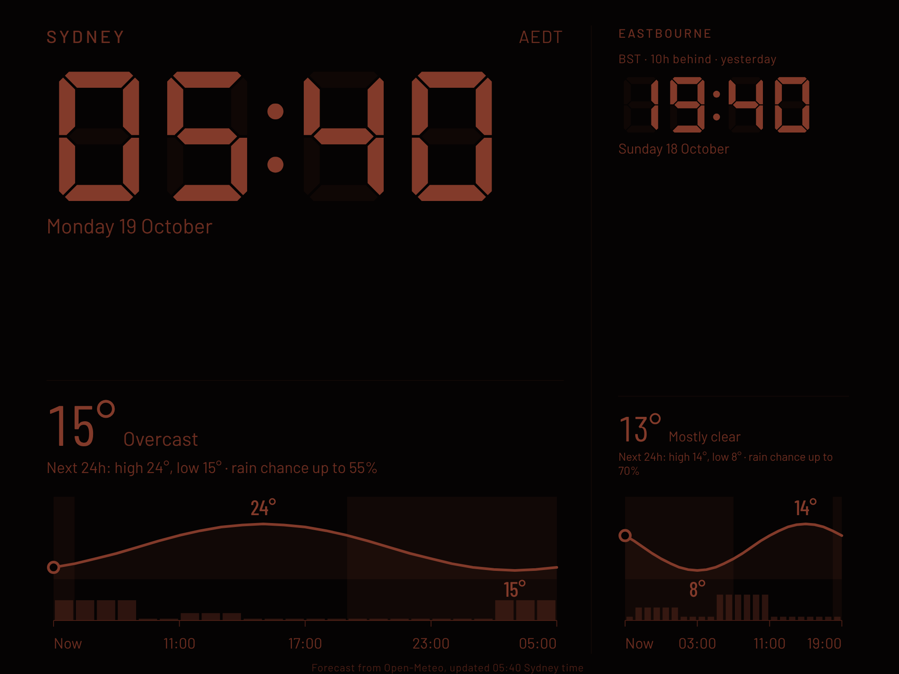

# Night Clock

A bedside clock for an old iPad (6th generation, iPadOS 17). It shows the time in Sydney and the UK (Eastbourne), how far apart they are, and the weather for the next 24 hours in both places. Warm red seven-segment digits on black, dims itself at night.



Plain HTML, CSS and JavaScript. No build step, no dependencies, no API keys. Forecasts come from [Open-Meteo](https://open-meteo.com).

## Put it on the iPad

1. Host the folder as a website. The simplest way is GitHub Pages: repository Settings, Pages, deploy from the `main` branch, root folder. (Free GitHub accounts need the repository to be public for Pages.)
2. On the iPad open the site in Safari.
3. Tap Share, then Add to Home Screen. Open it from the new icon and it runs full screen.
4. Settings, Display & Brightness, Auto-Lock, Never. Keep the iPad plugged in.
5. Optional: Settings, Accessibility, Display & Text Size, Reduce White Point, for a dimmer minimum brightness.
6. Optional: Settings, Accessibility, Guided Access, so a stray touch cannot leave the clock.

## Using it

Tap anywhere to show the controls for eight seconds.

- Time: switch between 24 hour (the default) and 12 hour.
- Brightness: Auto (dim between 9pm and 6am Sydney time), Bright, Dim, Dimmest.
- The Earlwood page has Brightness and Full screen only (24 hour time is fixed there). Full screen: shown in browsers that allow it (such as Chrome on an Android tablet). It hides the address bar. Not shown when the page is opened from the Home Screen.

Choices are remembered on the iPad. Landscape is the main layout. Portrait also works.

## Earlwood-only clock

A second page at `/earlwood/` (for example `https://konradwhiting.github.io/night-clock/earlwood/`) shows only Earlwood: one large clock and a forecast made of text and numbers (no charts, no headlines): temperature, a plain-words rain outlook, the next two hours, and temperature and rain chance every three hours. It scales to short, wide tablet screens. It uses the same code and headlines as the main page, so there is nothing extra to maintain. Add it to the Home Screen separately and it gets its own icon, named Earlwood Clock. The 24 or 12 hour and brightness choices are shared with the main clock, since both pages live on the same site.

## Sydney rain

The Sydney column puts rain first. It shows a one-line outlook, the chance now, the peak chance and when, the millimetres expected, a strip for the next two hours and a 24 hour rain-chance chart. Temperature is one small line.

The numbers come from Open-Meteo for Earlwood. Weather models work on a grid roughly 10 km wide, so they cannot tell one street or park from another, and the next-2-hours strip is the model's estimate, not radar. The location is set to the suburb on purpose, as the repository is public.

## Headlines

The blank space in each column shows the top regional headline: Earlwood news (searched from Google News, falling back to Canterbury-Bankstown and Inner West, then ABC News NSW) for the left column and BBC News Sussex for Eastbourne (BBC News England if the Sussex feed is unavailable). They are hidden in portrait.

A browser cannot read those RSS feeds directly, so a scheduled GitHub Action (`.github/workflows/news.yml`) fetches them once an hour and commits `news.json` when a headline changes. The page reads `news.json`. To refresh by hand, open the Actions tab, choose Update headlines, then Run workflow. Headlines are shown with their source for personal use.

## What it does for a night screen

- The picture shifts a few pixels every minute to protect the display.
- If the network drops, the last forecast stays on screen with the time it was fetched.
- Open clocks check every half hour whether a new version has been published and reload themselves when it has. They also reload around 3am Sydney time once a day. (When changing the code, bump `BUILD` at the top of `app.js` so open clocks notice.)
- Daylight saving is handled by the browser's time zone data, so the gap to the UK changes correctly (10 hours now, 11 hours after the UK clocks go back on 25 October 2026).

## Run it on a computer

```
python3 -m http.server 8000
```

Then open http://localhost:8000.

## Files

| File | Purpose |
|------|---------|
| `index.html` | Page structure and Home Screen settings |
| `styles.css` | Layout and the night colour scheme |
| `app.js` | Clock, time zones, forecast fetch and chart, headlines, controls |
| `scripts/update-news.mjs`, `.github/workflows/news.yml` | Fetch the regional headlines on a schedule |
| `news.json` | Latest headlines, written by the workflow |
| `earlwood/` | The Earlwood-only page and its Home Screen manifest |
| `manifest.webmanifest`, `icon-*.png` | Home Screen install |
| `fonts/` | Seven-segment digit font (DSEG7 Classic, SIL Open Font License, licence included) |
| `docs/requirements.md` | Product backlog, open questions and feedback log |
| `docs/design.md` | Earlwood page design and how it works, with diagrams |

## Known limits

- iPadOS 17 may not honour the screen wake lock for Home Screen apps, so Auto-Lock set to Never is the reliable way to keep the screen on.
- Forecast locations are Eastbourne, East Sussex and Earlwood in Sydney. They are set at the top of `app.js`.
