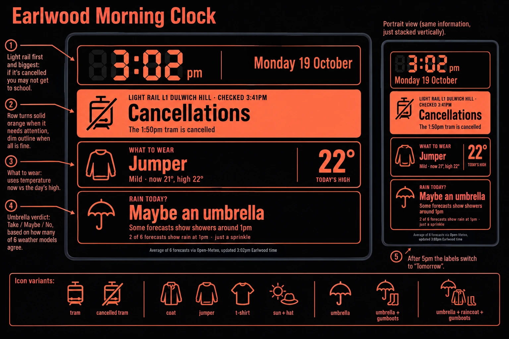
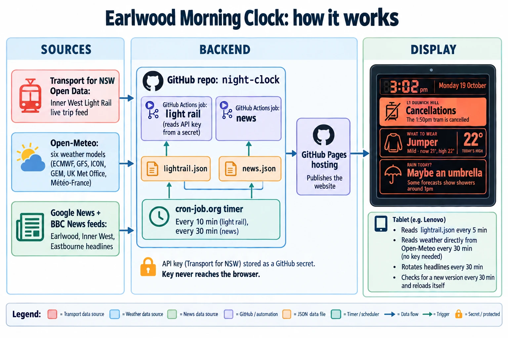

# Earlwood Morning Clock: design

The Earlwood page (`/earlwood/`) is a wall display for getting ready for school. It answers three questions at a glance, from across the room: is the light rail running, what do I wear, do I need an umbrella.

The two diagrams below were drawn by ChatGPT from prompts written for this project, then reviewed against the real build. Where a diagram differs from what was built, the notes under it say so. The built page is the source of truth.

## The screen

How the screen works:

- **Clock strip.** Large seven-segment time (12 hour on this page) and the date.
- **Light rail row (first, biggest).** Words follow Transport for NSW: "Delays" and "Cancellations". The row also says when it was last checked. Normal service reads "Running normally" for now, until the exact words are chosen. On weekdays it follows her own trips instead of the whole line: before midday the trams from Dulwich Hill to Jubilee Park between 7:15am and 8:30am, and after midday the trams from Jubilee Park back to Dulwich Hill between 3pm and 4pm. It lists each tram with its time and whether it is on time, late or cancelled. Outside those windows, and at weekends, it shows the whole line. The stops are set in `MY_TRIPS` in `scripts/update-lightrail.mjs`.
- **What to wear row.** Compares the temperature now with the day's high, so a cold morning that warms up says "Coat" with a note that a lighter layer will do later. The big number is the day's high.
- **Rain row.** The umbrella verdict comes from how many of six weather models expect rain: half or more means "Take an umbrella", a third or more means "Maybe an umbrella", otherwise "No umbrella". Very wet days add gumboots and a raincoat.
- **Attention.** A row turns solid orange when it needs attention (light rail delays or cancellations, umbrella needed). Otherwise it is a dim outline.
- **Colours.** Four daytime looks take turns, one per day (daylight cream, slate and teal, traffic light, sky blue). From 8pm to 6am the warm night look takes over. The Colours button in the settings panel (tap the screen) pins one look, or goes back to rotating.
- **After 5pm** the page switches to tomorrow (labels read "Tomorrow", the window is 6am to 6pm).

Differences between the diagram and the built page:

- Callout 1 ("Light rail first and biggest") has its arrow pointing at the clock. It belongs on the light rail row.
- The clock strip and the "22°" block are drawn with box borders and a divider. On the real page the clock has no box, and the "22°" has no divider.
- The portrait mock-up is accurate in content. The real portrait layout gives the rows more height.

## How it works

In short:

- **Light rail.** A GitHub Actions job reads the Transport for NSW live feed with an API key stored as a GitHub secret, and writes `lightrail.json`. The key never reaches the browser.
- **News.** A second job reads Google News and BBC feeds and writes `news.json` (several headlines per place, rotated every 30 minutes on the two-city page).
- **Timers.** GitHub's own scheduler proved unreliable, so cron-job.org triggers the jobs: light rail every 10 minutes, news every 30 minutes (the news timer is still to be set up).
- **Weather.** The tablet reads Open-Meteo directly (no key needed) every 30 minutes and averages six models.
- **Hosting.** GitHub Pages publishes the site. The page checks for a new version every 30 minutes and reloads itself.

Differences between the diagram and the built system:

- The arrows between the jobs, the JSON files and the timer are drawn the wrong way round. The correct flow is: cron-job.org triggers each Actions job, each job writes its JSON file into the repo, and GitHub Pages publishes the repo to the tablet.
- Open-Meteo is drawn feeding the backend. The tablet actually reads weather straight from Open-Meteo, as the tablet box on the right says.
- Each source should point at its own job (Transport for NSW to the light rail job, the news feeds to the news job), not at the repo box as a whole.
